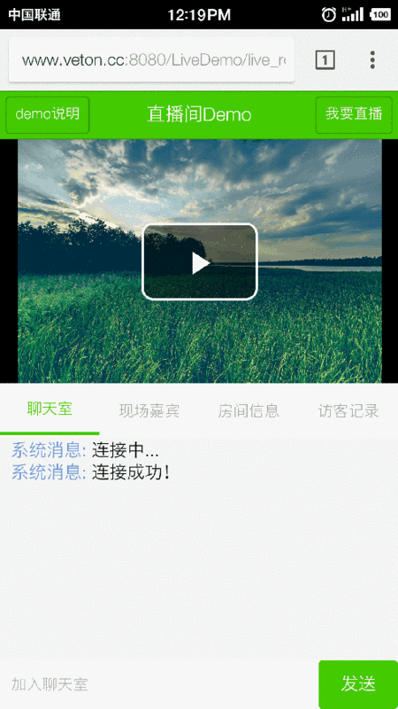
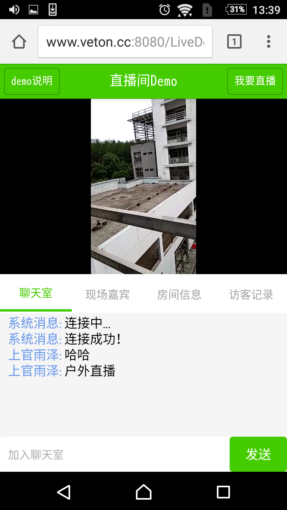
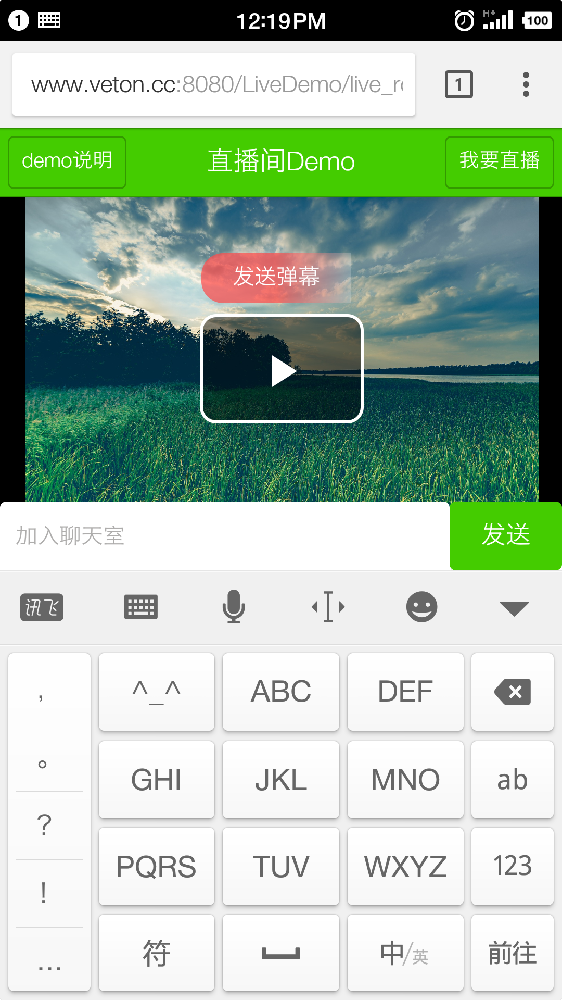

# LiveRoomDemo（移动端）

[](LICENSE)
[](https://v2.vuejs.org/)
[](https://nodejs.org/)

一个直播间 Demo 的移动端，用 Vue 2 写的，实现了：

- 拉取 HLS 直播流播放
- 基于 WebSocket(STOMP) 的直播聊天室
- 与聊天内容联动的直播间弹幕
- 实时在线人数和访客记录

需要配合服务端
[LiveRoomDemo_Server](https://github.com/jack-hoo/LiveRoomDemo_Server) 使用。

English: [README.md](README.md)

---

## 目录

- [运行截图](#运行截图)
- [技术栈](#技术栈)
- [环境要求](#环境要求)
- [快速开始](#快速开始)
- [配置](#配置)
- [项目结构](#项目结构)
- [构建与部署](#构建与部署)
- [已知限制](#已知限制)
- [参与贡献](#参与贡献)
- [开源协议](#开源协议)

## 运行截图






## 技术栈

| 用途 | 选型 |
| --- | --- |
| 框架 | Vue 2 + vue-router 2 + vuex 2 |
| UI | [Vonic](https://github.com/wangdahoo/vonic) 2.0 |
| HTTP | axios |
| 播放器 | vue-video-player + videojs-contrib-hls |
| WebSocket | vue-stomp（STOMP over SockJS） |
| 弹幕 | vue2-barrage |
| 构建 | webpack 2 |

## 环境要求

> ### ⚠️ 只能用 Node 8
>
> 本项目的构建链停留在 **webpack 2 + node-sass 4.x**。`node-sass@4` 没有为
> Node 9 及以上版本提供预编译二进制，装依赖这一步就会失败——根本走不到构建。
>
> ```bash
> nvm install 8
> nvm use 8
> node -v        # 应该是 v8.x.x
> ```
>
> 没装 [nvm](https://github.com/nvm-sh/nvm) 的话先装一个，不建议把系统全局的
> Node 降到 8。
>
> `npm run dev` / `npm run build` 启动时会先做版本检查，版本不对会直接给出提示而不是
> 让你去猜 node-sass 的编译错误。

**为什么不升级工具链？** 这次整理的目标是修 Bug、清理隐私数据、补齐开源规范，
同时保留项目原貌，所以刻意没有动框架和构建工具。如果你想让它跑在现代 Node 上，
可行的路线有两条：

- **迁到 Vite + Vue 2.7**：保留全部组件代码和 vonic，只换构建工具，
  并把 `node-sass` 换成 `sass`（dart-sass）。工作量可控，但 vonic、vue-stomp
  这些老库对 ESM 的兼容需要逐个验证。
- **重写为 Vue 3 + Vite**：vonic 是 Vue 2 专用的 UI 库，vue2-barrage、
  vue-video-player 也都要换，等于把 7 个组件重写一遍。

两条路都欢迎提 PR，但请先开 Issue 讨论。

## 快速开始

### 1. 启动服务端

先把 [LiveRoomDemo_Server](https://github.com/jack-hoo/LiveRoomDemo_Server) 跑起来，
默认监听 `http://127.0.0.1:8085`。没有服务端的话聊天室连不上，播放器也拿不到访客数据。

### 2. 安装依赖

```bash
nvm use 8
npm install
```

> 国内网络装依赖慢的话，可以临时指定镜像（不建议写进仓库的 `.npmrc`，
> 那会强制所有人都走同一个源）：
>
> ```bash
> npm install --registry=https://registry.npmmirror.com \
>             --sass-binary-site=https://npmmirror.com/mirrors/node-sass
> ```

### 3. 配置直播源

编辑 `config/prod.env.js`，填上你自己的直播地址（见下面的 [配置](#配置) 一节）。
不填也能跑，只是播放器区域会显示「未配置直播源」，聊天室和弹幕照常可用。

### 4. 启动开发服务器

```bash
npm run dev
```

打开 <http://localhost:8080>。开发服务器会把 `/LiveDemo` 前缀的请求代理到
`http://127.0.0.1:8085`，WebSocket 也一并转发。

用手机访问的话，把 `localhost` 换成你电脑的局域网 IP，
并把服务端的 `CORS_ALLOWED_ORIGINS` 改成对应地址。

### 5. 生产构建

```bash
npm run build
```

产物在 `dist/`。

## 配置

所有运行时配置集中在 `config/prod.env.js`，由 webpack 在构建时注入，
读取逻辑在 `src/config/index.js`。

> **注意写法**：这些值会被 `webpack.DefinePlugin` **原样替换**到代码里，
> 所以每个值都必须是一段合法的 JS 源码——字符串要带上内层引号，写成 `'"..."'`。

| 配置项 | 默认值 | 说明 |
| --- | --- | --- |
| `API_BASE` | `"/LiveDemo"` | 后端接口前缀，要和服务端 `server.context-path`（或 war 包名）一致 |
| `HLS_SOURCE` | `""` | 直播源(m3u8)。留空则显示「未配置直播源」 |
| `PLAYER_POSTER` | `""` | 播放器封面图 |
| `PUBLISH_URL` | `""` | 推流地址，用于「我要直播」的提示文案 |
| `PUBLISH_PLAYBACK_URL` | `""` | 点击「我要直播」后切换到的播放地址 |

示例：

```js
// config/prod.env.js
module.exports = {
  NODE_ENV: '"production"',
  API_BASE: '"/LiveDemo"',
  HLS_SOURCE: '"https://live.example.com/hls/demo.m3u8"',
  PLAYER_POSTER: '""',
  PUBLISH_URL: '"rtmp://live.example.com/live/demo"',
  PUBLISH_PLAYBACK_URL: '"https://live.example.com/hls/demo.m3u8"'
}
```

只想改开发环境的话，在 `config/dev.env.js` 里覆盖对应项即可。

开发服务器的代理目标可以通过环境变量临时改：

```bash
API_TARGET=http://192.168.1.100:8085 npm run dev
```

搭建自己的推流服务（nginx-rtmp）见服务端仓库的
[docs/DEPLOYMENT.md](https://github.com/jack-hoo/LiveRoomDemo_Server/blob/master/docs/DEPLOYMENT.md)。

## 项目结构

```
├── build/                  # webpack 构建脚本
├── config/
│   ├── index.js            # 构建路径、dev server、接口代理
│   ├── dev.env.js          # 开发环境运行时配置
│   └── prod.env.js         # 生产环境运行时配置 ← 改这里
├── src/
│   ├── main.js             # 入口：注册插件、定义路由
│   ├── config/index.js     # 运行时配置的读取出口
│   ├── api/api.js          # 后端接口
│   ├── components/
│   │   ├── Index.vue       # 外层布局：播放器 + 底部 tab
│   │   ├── chatroom.vue    # 聊天室 + 弹幕
│   │   ├── guest.vue       # 现场嘉宾（在线用户）
│   │   ├── history.vue     # 访客记录
│   │   ├── roominfo.vue    # 房间信息
│   │   ├── About.vue       # demo 说明
│   │   └── feedback.vue    # 问题反馈
│   ├── vuex/               # 全局状态（在线用户列表）
│   └── public/             # 工具函数与第三方脚本
├── static/screenshot/      # README 用的截图
├── index.html              # 开发模式的 HTML 模板
└── index.tpl.html          # 生产构建的 HTML 模板
```

## 构建与部署

移动端不单独部署，构建产物需要拷进服务端的静态资源目录，由服务端一并托管。

```bash
npm run build
```

对应关系：

| 本仓库产物 | 服务端位置 |
| --- | --- |
| `dist/index.html` | `src/main/resources/templates/live_m.html` |
| `dist/js/*.js` | `src/main/resources/static/js/` |
| `dist/css/*.css` | `src/main/resources/static/css/` |
| `dist/vonic/*` | `src/main/resources/static/vonic/` |

产物里的资源路径都是相对形式（`js/xxx.js`），拷过去正好对应服务端在 `/LiveDemo`
下的托管路径，不需要手工改任何地址。

`live_m.html` 引用的是带 hash 的文件名，每次构建都会变，所以 html 和 js/css
必须整套一起替换，并删掉旧 hash 的文件。详细步骤见服务端的
[部署文档](https://github.com/jack-hoo/LiveRoomDemo_Server/blob/master/docs/DEPLOYMENT.md#6-同步移动端构建产物)。

## 已知限制

- **只能用 Node 8 构建**，原因见 [环境要求](#环境要求)。
- **移动端用 QQ、UC 等浏览器播放过视频后，输入框和弹幕会被遮挡**。
  这类浏览器会劫持页面里的 `<video>` 标签强制全屏播放，盖住页面上的其他元素。
  很多直播平台的移动端都有同样的问题。规避办法：用 Chrome（手机端）访问，
  或改用电脑端页面。
- 聊天消息不做持久化，刷新页面即清空。
- 生产构建把 Vue / vue-router / axios / vonic 配成了 `externals`（不进 bundle，
  运行时从全局变量取），因此 `index.tpl.html` 必须显式加载这几个文件。
  它们现在由构建过程从 `node_modules` 拷进产物，不再依赖外部 CDN。

## 参与贡献

欢迎提 Issue 和 PR，请先阅读 [CONTRIBUTING.md](CONTRIBUTING.md)。

## 开源协议

[MIT](LICENSE) © jack-hoo
